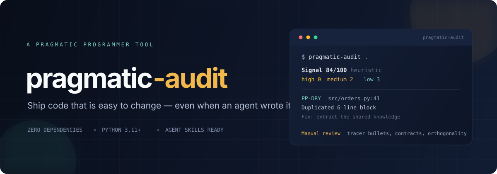
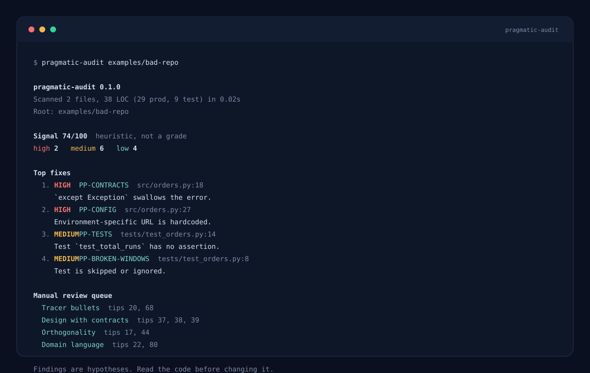
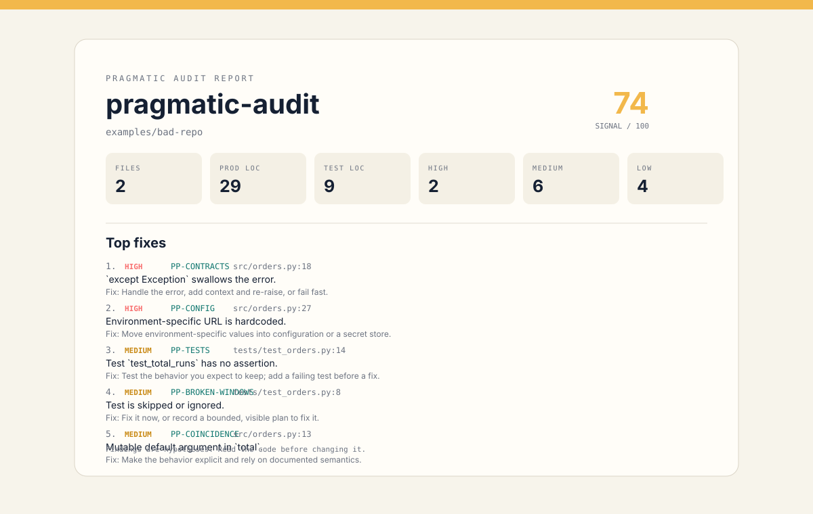

<div align="center">



<br>

[](https://github.com/CobaltChaser/pragmatic-audit/actions/workflows/ci.yml)
[](https://www.python.org/)
[](#what-it-will-not-do)
[](LICENSE)
[](CONTRIBUTING.md)
[](docs/agent-skill.md)

</div>

AI made writing code cheap. Changing it is still expensive.

`pragmatic-audit` checks a repository against the durable principles from *The Pragmatic Programmer* — DRY, orthogonality, contracts, resource ownership, external configuration, tests, and more — then hands the judgment calls to your agent with a focused review packet.

It is for humans reviewing agent output, and for agents that need to write code worth keeping.



## Why this matters in the agentic era

Agents can produce code faster than humans can review it. They also copy patterns — including bad ones — at scale. Prototypes that were meant to be thrown away become production systems, and the small compromises compound.

The bottleneck has moved. It is no longer how fast a team can type. It is how cheaply the code can change next week.

Principles are portable guardrails. They survive model upgrades, framework churn, and team changes. A deterministic audit gives humans and agents the same vocabulary for a review:

- **DRY** asks whether one piece of knowledge has one authoritative home.
- **Orthogonality** asks whether a change stays local.
- **Contracts** ask whether a boundary fails loudly or lies quietly.
- **Resource ownership** asks who closes what they opened.
- **Tests** ask whether behavior is pinned down or merely exercised.

`pragmatic-audit` finds the mechanical violations. The bundled skill teaches an agent how to reason about the rest.

## What you get

| | |
|---|---|
| **Audit** | A fast, offline scan with file-and-line findings, severity, confidence, and a concrete fix. 20 core checks, plus 3 opt-in history checks. |
| **Explain** | Every finding names the principle and tip it comes from. The report separates mechanical findings from questions that need human judgment. |
| **Coach** | `--agent-packet` writes a JSON and Markdown briefing your agent can use to review the code, confirm or dismiss findings, and propose the smallest useful change. |

No network. No telemetry. No LLM calls inside the CLI. No dependencies outside the Python standard library.

## Quick start

Run it against any repository without installing anything:

```bash
git clone --depth 1 https://github.com/CobaltChaser/pragmatic-audit.git /tmp/pragmatic-audit
cd /tmp/pragmatic-audit && python3 -m pragmatic_audit /path/to/repo
```

Or install the CLI once:

```bash
pipx install git+https://github.com/CobaltChaser/pragmatic-audit.git
pragmatic-audit .
```

Common modes:

```bash
# Human-readable report
pragmatic-audit .

# Stable JSON for CI and agents
pragmatic-audit . --format json

# Findings plus a review packet for your coding agent
pragmatic-audit . --agent-packet

# Fail the build on high-severity findings
pragmatic-audit . --ci --fail-on high
```

Python 3.11 or newer. Nothing else.

## Install the agent skill

The skill lives in [`skills/pragmatic-programmer`](skills/pragmatic-programmer). Every command below is repeatable and self-cleaning.

### Claude Code

```bash
rm -rf ~/.cache/pragmatic-audit && git clone --depth 1 https://github.com/CobaltChaser/pragmatic-audit.git ~/.cache/pragmatic-audit && mkdir -p ~/.claude/skills && cp -R ~/.cache/pragmatic-audit/skills/pragmatic-programmer ~/.claude/skills/
```

### Claude Cowork / claude.ai

```bash
rm -rf ~/.cache/pragmatic-audit && git clone --depth 1 https://github.com/CobaltChaser/pragmatic-audit.git ~/.cache/pragmatic-audit && cd ~/.cache/pragmatic-audit/skills && zip -r ~/Downloads/pragmatic-programmer.zip pragmatic-programmer
```

Then open **Customize → Skills → Upload** and select `pragmatic-programmer.zip`.

### ChatGPT Work / CoWork

```bash
rm -rf ~/.cache/pragmatic-audit && git clone --depth 1 https://github.com/CobaltChaser/pragmatic-audit.git ~/.cache/pragmatic-audit && cd ~/.cache/pragmatic-audit/skills && zip -r ~/Downloads/pragmatic-programmer.zip pragmatic-programmer
```

Then open **Plugins → Skills → Create → Upload from your computer** and select the ZIP.

For local Codex:

```bash
rm -rf ~/.cache/pragmatic-audit && git clone --depth 1 https://github.com/CobaltChaser/pragmatic-audit.git ~/.cache/pragmatic-audit && mkdir -p ~/.codex/skills && cp -R ~/.cache/pragmatic-audit/skills/pragmatic-programmer ~/.codex/skills/
```

### OpenCode

```bash
rm -rf ~/.cache/pragmatic-audit && git clone --depth 1 https://github.com/CobaltChaser/pragmatic-audit.git ~/.cache/pragmatic-audit && mkdir -p ~/.config/opencode/skills && cp -R ~/.cache/pragmatic-audit/skills/pragmatic-programmer ~/.config/opencode/skills/
```

Project-local variant:

```bash
mkdir -p .opencode/skills && cp -R /path/to/pragmatic-audit/skills/pragmatic-programmer .opencode/skills/
```

### Everything else (Agent Skills standard)

```bash
rm -rf ~/.cache/pragmatic-audit && git clone --depth 1 https://github.com/CobaltChaser/pragmatic-audit.git ~/.cache/pragmatic-audit && mkdir -p ~/.agents/skills && cp -R ~/.cache/pragmatic-audit/skills/pragmatic-programmer ~/.agents/skills/
```

Host notes:

- Claude Code reads `~/.claude/skills/` and `.claude/skills/`.
- OpenCode reads `~/.config/opencode/skills/`, `~/.claude/skills/`, `~/.agents/skills/`, and their project equivalents.
- Codex reads local skills from `~/.codex/skills/`. ChatGPT workspace skills are uploaded through the UI.
- Cursor and other compatible hosts can use `~/.agents/skills/` or their documented local skill directory.
- Keep `SKILL.md` at the root of the skill folder. The folder name must match the skill name.

See [docs/agent-skill.md](docs/agent-skill.md) for invocation examples and compatibility notes.

## Use it in CI

```yaml
name: pragmatic-audit

on:
  push:
  pull_request:

jobs:
  audit:
    runs-on: ubuntu-latest
    steps:
      - uses: actions/checkout@v4
      - uses: actions/setup-python@v5
        with:
          python-version: "3.12"
      - run: pipx install git+https://github.com/CobaltChaser/pragmatic-audit.git
      - run: pragmatic-audit . --ci --fail-on high --format markdown --output pragmatic-audit.md
      - uses: actions/upload-artifact@v4
        if: always()
        with:
          name: pragmatic-audit
          path: pragmatic-audit.md
```

Exit codes:

| Code | Meaning |
|---|---|
| `0` | Audit completed, gate passed |
| `1` | Audit completed, gate failed |
| `2` | Invalid usage or unreadable path |
| `3` | Internal error |

The gate is opt-in. By default the CLI reports and exits `0`. Use `--fail-on medium` when the codebase is ready for a stricter ratchet.

## The 20 core checks

<details>
<summary><strong>Open the rule table</strong></summary>

<br>

| Rule | Principle | What it catches |
|---|---|---|
| `PP-DRY` | Don't repeat yourself | Duplicated normalized blocks of 6+ lines and duplicate functions |
| `PP-CONFIG` | External configuration | Hardcoded secrets, environment URLs, absolute paths, and non-local IPs |
| `PP-MAGIC` | Policy is metadata | Unexplained numeric thresholds in comparisons |
| `PP-ORTHO` | Orthogonality | Import cycles and modules with excessive internal fan-out |
| `PP-GLOBALS` | Avoid global data | Module-level mutable state, `global`, and mutable defaults |
| `PP-TRAINWRECK` | Decoupled code | Call chains that reach through three or more objects |
| `PP-INHERIT` | Composition over inheritance | Inheritance depth over two |
| `PP-CONTRACTS` | Design with contracts | Empty catches, swallowed errors, and bare `except` |
| `PP-RESOURCES` | Resource ownership | Acquired resources without a guaranteed release path |
| `PP-COINCIDENCE` | Rely on reliable things | Mutable defaults, float equality, loose JS equality, and stale `var` |
| `PP-COMPLEXITY` | Good design is easier to change | Long functions, deep nesting, high branch count, and too many parameters |
| `PP-NAMING` | Express intent | Single-letter and generic names, and vague boolean names |
| `PP-COMMENTS` | Good code is its own documentation | Commented-out code blocks |
| `PP-BROKEN-WINDOWS` | Fix bad code when you see it | Skip markers, unexplained suppressions, and TODO/FIXME density |
| `PP-TESTS` | Design to test | Missing tests, thin coverage, and assertion-free tests |
| `PP-TEST-HYGIENE` | A good test is a good neighbor | Sleeps, real network calls, and nondeterministic input in tests |
| `PP-AUTOMATION` | Automate the routine | Missing CI, task automation, and unscripted release steps |
| `PP-VCS` | Version control everything | Missing git, missing `.gitignore`, tracked secrets, and large files |
| `PP-E2E` | Build end-to-end | Unit-only suites with no smoke or end-to-end path |
| `PP-DOCS` | Documentation lives with the code | Missing or unhelpful README documentation |

</details>

Opt-in history and architecture checks:

| Rule | Principle | What it catches |
|---|---|---|
| `PP-SMALL-STEPS` | Small reversible steps | Commits touching more than 30 files or 1,000 lines |
| `PP-REVERSIBILITY` | There are no final decisions | Vendor SDKs spread across modules without an adapter boundary |
| `PP-SHARED-STATE` | Avoid shared mutable state | Mutable module state in files that use concurrency |

Enable them with `--include-history` or `--all`.

Full rationale, examples, false positives, and tuning: [docs/rules.md](docs/rules.md).

## Hybrid by design

Static analysis is good at finding mechanical violations. It is bad at judging design.

This tool does not pretend otherwise.

1. **The scanner** produces deterministic findings with locations and fixes. It reads Python and JavaScript/TypeScript structurally, and uses conservative text heuristics for Go, Java, Ruby, PHP, Rust, and others.
2. **The report** adds a manual review queue: tracer bullets, boundary contracts, orthogonality, domain language, reversibility, test design, and speculative code.
3. **The packet** gives an agent the evidence and a question set. The agent must open the files, confirm or dismiss each finding, and report only the few changes that most improve changeability.

```bash
pragmatic-audit . --agent-packet
```

That writes `pragmatic-audit.packet.json` and `pragmatic-audit.packet.md` in the current directory. Neither file is required for normal use; both are designed to be pasted into an agent session.

## What it will not do

- It will not auto-fix code.
- It will not make network requests or call an LLM.
- It will not replace your linter, type checker, test runner, or security scanner.
- It will not produce a definitive quality score. The number is directional and always shown next to raw counts.
- It will not understand every framework’s conventions. False positives are expected; dismiss them with a reason or tune the rule.
- It will not prove that code is correct.

Treat every finding as a hypothesis. Read the code before changing it.

## Example report

The bundled bad repository produces a real report: [examples/report.md](examples/report.md).



The examples are deliberately small and are used by the test suite:

```bash
pragmatic-audit examples/bad-repo
pragmatic-audit examples/good-repo
```

## Tuning

Create `.pragmatic-audit.toml` at the repository root:

```toml
[scan]
exclude = ["generated", "public/vendor", "*.min.js"]
languages = ["python", "javascript", "typescript"]

[thresholds]
long_function = 60
deep_nesting = 4
max_params = 5
test_ratio = 0.3

[ignore]
rules = ["PP-MAGIC"]
paths = ["migrations/**"]

[ci]
fail_on = "high"
min_confidence = "medium"
```

Suppress a single line when the finding is genuinely wrong:

```python
if len(items) > 42:  # pragmatic-audit: ignore PP-MAGIC pagination boundary from the API contract
```

Suppress a file when the whole file is a known exception:

```python
# pragmatic-audit: ignore-file PP-GLOBALS this module is the state owner
```

Every suppression needs a written reason. A suppression without a reason is a broken window.

## Self-audited

This repository runs `pragmatic-audit` on itself in CI, and the test suite includes the rules it ships. The current self-audit report is [examples/self-audit.md](examples/self-audit.md), generated by `scripts/self_audit.sh`.

The tool is not expected to score 100. It is expected to show its own trade-offs honestly, including deliberate exceptions and false positives.

## Contributing

**PRs are open.** This project gets better when more people encode the principles they actually use. Rule proposals, false-positive reports, new language patterns, docs fixes, and examples are all welcome.

Good first contributions:

- Add a language pattern to an existing rule, with a positive and negative fixture.
- Improve a rule description or a fix suggestion.
- Add a false-positive case that the current tests miss.
- Make an example repository more realistic.
- Tighten the docs.

Read [CONTRIBUTING.md](CONTRIBUTING.md) before opening a pull request. The short version:

```bash
python3 -m unittest discover -s tests -v
python3 -m compileall pragmatic_audit
python3 -m pragmatic_audit . --ci --fail-on high
```

No new runtime dependencies. Every rule needs a test. Every behavior claim needs a test or a code link.

- [Rule proposal template](.github/ISSUE_TEMPLATE/rule_proposal.yml)
- [Bug report template](.github/ISSUE_TEMPLATE/bug_report.yml)
- [Code of conduct](CODE_OF_CONDUCT.md)
- [Security policy](SECURITY.md)

## License

Apache-2.0. Use it at work, in commercial products, and in closed-source repositories. Keep the copyright, license, and [`NOTICE`](NOTICE) file, and state significant changes.

Full terms: [LICENSE](LICENSE).

## Credits

*The Pragmatic Programmer, 20th Anniversary Edition* is by David Thomas and Andrew Hunt. This project is an independent, unofficial tool. Tip names and numbers are referenced descriptively with attribution. No book text is reproduced. The project is not affiliated with the authors or The Pragmatic Programmers, LLC.

The audit text, prompts, and documentation in this repository are original paraphrases and implementations.
